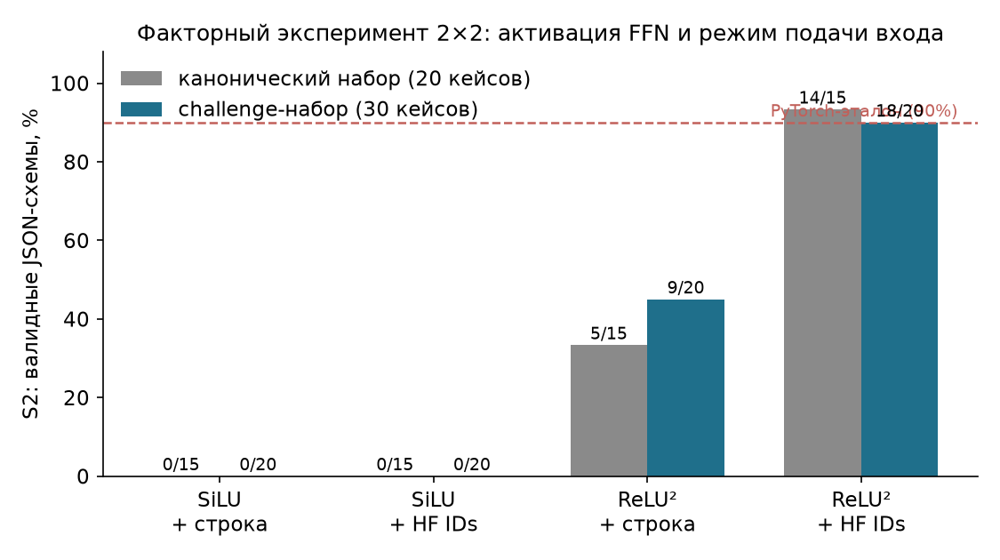
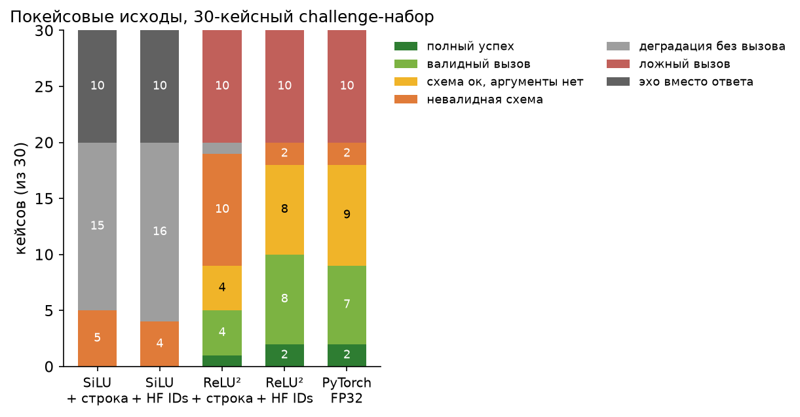
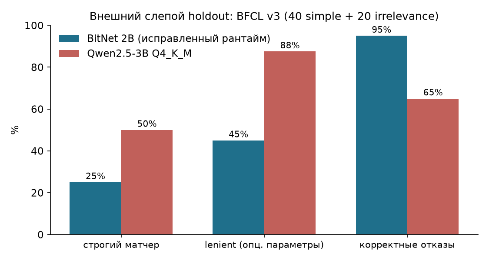
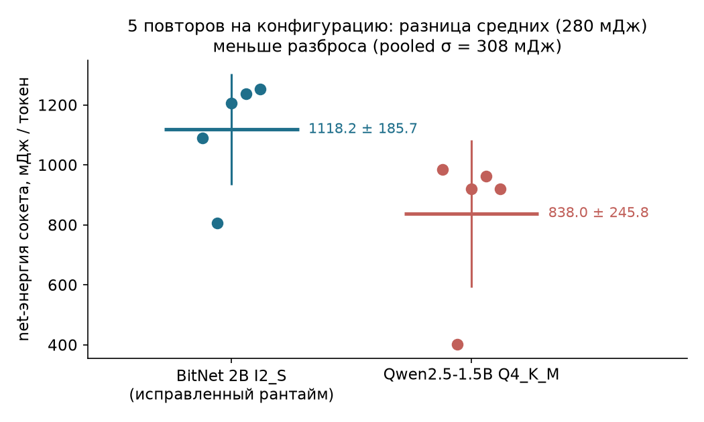

# Агенты на лёгких тернарных моделях: root-cause исследование провала tool calling в инференс-стеке BitNet b1.58 2B

**Статус документа:** рабочий черновик v2 (русский). Переписан с нуля на основе audit-слоя («Теор материалы») после того, как первоначальная интерпретация «деградации квантования» была опровергнута факторным экспериментом 2×2. Английская версия — после закрытия дыр фазы 1.
**Дата:** 19 октября 2026
**Артефактный репозиторий:** Публичный пакет воспроизводимости: [github.com/NoApexDB/bitnet-toolcalling-repro](https://github.com/NoApexDB/bitnet-toolcalling-repro) (тег `v1.0-submission`, манифест `BENCHMARK_ARTIFACTS_MANIFEST.json`, 81 запись с SHA-256). Локальный архив: `C:\ai_models\paper_artifacts\` (ревизии от 19.10.2026).
**Предыдущая версия отчёта:** сохранена в артефактном репозитории как `paper_artifacts\RESEARCH_PAPER_REPORT.md` (его центральная гипотеза опровергнута и в тексте статьи не используется)

> Пометки доказательности, как в audit-слое:
> **[Подтверждено]** — проверено по исходному коду, сырым JSON или побайтовым сравнением.
> **[Вывод]** — интерпретация, ограниченная условиями эксперимента.
> **[Пока не доказано]** — разумная гипотеза без прямого свидетельства.

---

## Аннотация

Тернарные модели (BitNet b1.58, веса из {−1, 0, +1}) обещают кратное сжатие памяти, однако публичных замеров их применимости в автономных агентных сценариях (вызов инструментов, селективность, удержание контекста) мы не нашли. Мы провели сквозное сравнение `BitNet-b1.58-2B-4T` с плотными моделями (Qwen2.5-1.5B/3B) в PyTorch и C++ рантайме `llama.cpp`/`bitnet.cpp`.

Установлено, что наблюдавшийся до исправления движка провал вызова инструментов обусловлен не квантованием, а дефектом графа: в FFN использовалась SiLU вместо требуемой архитектурой ReLU². После исправления доля синтаксически валидных JSON-схем выросла с 0/15 до 14/15 при неизменных весах [Подтверждено]. Второй источник расхождений — токенизация: пропуск метаданных предтокенизатора удлиняет C++ последовательности на 39–43 токена; переход на согласованные токены меняет долю валидных схем с 5/15 до 14/15 (тест Макнемара, p = 0.0039) [Подтверждено].

После устранения дефектов рантайма BitNet воспроизводит уровень полноточного PyTorch-бейзлайна. Ложные вызовы инструментов на нерелевантных запросах вызваны директивой промпта: мягкий фрейминг обеспечивает 7/10 корректных отказов против 0/10 при требовании «только JSON» [Подтверждено].

На процессоре архитектуры x86 тернарная модель уступает 4-битной плотной по скорости генерации (21.0 против 28.7 ток/с у Qwen 1.5B); энергия сокета в пределах шума измерений не различается. Выигрыш по памяти составляет −19% относительно 1.5B (1.38 против 1.69 ГБ) и в 2.4 раза относительно сопоставимой по агентной точности модели 3B (3.29 ГБ) [Подтверждено].

Главный вывод: тернарная архитектура способна к агентным задачам, но барьер внедрения на x86 лежит в селективности промпта и программном стеке, а не в потере информации квантованием.

---

## 1. Введение и исследовательские вопросы

Автономному LLM-агенту нужны четыре способности: различить, когда нужен внешний инструмент (trigger discrimination); извлечь аргументы в жёсткую JSON-схему (slot filling); удержать ссылки между ходами диалога (анфора); уложиться в ограниченные память и энергию. Для тернарных моделей всё это вне перплексии и MMLU практически не измерялось (см. §2).

Исследование началось с практического вопроса: **можно ли строить локального агента на BitNet b1.58 2B в C++ рантайме на обычном x86 CPU?** Ответ прошёл через три фазы понимания:

- фаза A: «PyTorch показывает отличные агентные способности, C++ рантайм показывает ноль — значит, виновато 2-битное квантование» (гипотеза, позже опровергнутая);
- фаза B: root-cause показал баг графа (SiLU вместо ReLU²) и расхождение токенизации;
- фаза C: после исправления рантайма остались настоящие ограничения модели — селективность и аргументная точность.

Исследовательские вопросы в итоговой формулировке:

- **RQ1.** Воспроизводится ли агентное поведение BitNet 2B из PyTorch в C++ рантайме, и какова причина расхождения? *(→ §4)*
- **RQ2.** Повреждает ли конверсия чекпойнта в I2_S/GGUF тернарные веса? *(→ §4.3)*
- **RQ3.** Каков вклад режима подачи входа (токенизация) в расхождение рантаймов? *(→ §4.5–4.6)*
- **RQ4.** Каковы остаточные способности к tool calling после исправления рантайма: схема, аргументы, исполнение, селективность? *(→ §5)*
- **RQ5.** Каковы память, скорость и энергия тернарного стека на commodity x86? *(→ §6)*

---

## 2. Связанные работы

Линейка BitNet началась с архитектуры BitLinear [1]: бинарные веса, обучение с нуля, конкурентная перплексия при меньших памяти и энергии. Вариант b1.58 [2] расширил веса до тернарных {−1, 0, +1} (log₂3 ≈ 1.58 бита) и заявил паритет с FP16-моделями того же размера, начиная примерно с 3B параметров. Оценка энергии там опирается на стоимости отдельных арифметических операций по модели Хоровица [5]: FP16-умножение ≈ 3.7 пДж против ≈ 0.05 пДж за сложение 1.58-битных весов, откуда и берётся разница в десятки раз. Отчёт о BitNet b1.58 2B4T [3] — первая открытая нативно-тернарная модель масштаба 2B (обучена на 4 трлн токенов); в нём заявлены 0.028 Дж/токен декодирования против 0.186–0.649 Дж у полноточных моделей того же класса. Оба числа — расчёт по операции, а не замер: DRAM, uncore и накладные расходы рантайма в них не входят. Инференс-фреймворк bitnet.cpp [4] дал формат упаковки I2_S и lookup-ядра; заявленные ускорения 2.37–6.17× на x86 и снижение энергии на 71.9–82.2% — **относительно FP16-базлайна**, что важно для интерпретации наших результатов: против зрелых 4-битных форматов это преимущество не обязано сохраняться, и в §6.3 оно не сохраняется.

Снаружи Microsoft тернарное направление развивают Falcon-Edge (TII) [9], Ternary Bonsai (Prism ML; заявляет поддержку tool calling, но без публикуемых агентных бенчмарков) [10], MoE-модель Maple [11] и пост-трениговые методы квантизации до 1.58 бита (CAT-Q [12], TWLA [13]). Полный обзор с датами и метриками мы вынесли в `paper_artifacts/LITERATURE_AND_ROADMAP.md`; по состоянию на этот обзор (октябрь 2026) общий знаменатель один: все эти работы измеряют перплексию и одношаговые тесты (MMLU, GSM8K, ARC, IFEval), и мы не нашли публичных замеров поведения тернарных моделей в агентных циклах — вызовы инструментов, удержание контекста, селективность, retry-циклы парсинга (искали: arXiv, карточки моделей Hugging Face, GitHub, лидерборды BFCL и APIBench). Ближайший прецедент — экспериментальная Falcon-E-1.2-3B-Exp (TII) [14]: тернарная модель, дообученная на агентных SFT-данных из prequantized-чекпоинта, т.е. QAT-подход, ортогональный нашей находке о том, что пост-хок слияние LoRA решётку не переживает; публичных агентных замеров этой модели мы также не нашли. Существующие бенчмарки tool calling — APIBench и Berkeley Function Calling Leaderboard из проекта Gorilla [6] — фиксируют, что даже GPT-4 страдает от неверных аргументов и галлюцинаций вызовов; они и задали нам протокол внешней проверки (§5.6). Плотный бейзлайн — Qwen2.5 [7].

Отсюда два пробела, которые закрывает эта работа. Первый: публичных замеров агентного поведения тернарных моделей мы не нашли (насколько позволяет наш поиск — см. выше) — публичного ответа на вопрос «можно ли строить локального агента на BitNet» не существовало. Второй: энергетические заявления Microsoft не проверялись физическим замером на серийном железе. Мы закрываем оба, и по ходу выясняется, что оба пробела прячут ловушку: измеренное «поведение модели» может оказаться поведением рантайма (§4).

---

## 3. Методология

### 3.1 Модели и конфигурации

| ID | Модель | Рантайм / формат | Примечание |
| :--- | :--- | :--- | :--- |
| `bitnet_base` | BitNet-b1.58-2B-4T | PyTorch FP32 (CUDA/CPU) | FP32 обязателен: FP16 даёт NaN в SubLN (см. §7.1) |
| `bitnet_distilled` | + LoRA v1 (25 тул-диалогов) | PyTorch FP32 | |
| `bitnet_balanced` | + LoRA v2 (45 сбалансированных) | PyTorch FP32 | |
| `bitnet_i2s` | то же | C++ `llama-server`, GGUF I2_S (1.18 ГБ) | два бинарника: SiLU-граф и ReLU²-граф |
| `qwen2.5_1.5b` | Qwen2.5-1.5B-Instruct | PyTorch FP16 / C++ Q4_K_M (1.04 ГБ) | |
| `qwen2.5_3b` | Qwen2.5-3B-Instruct | C++ Q4_K_M (1.95 ГБ) | |

### 3.2 Лестница оценки S1–S5

Ключевая методологическая единица работы. Единый оценщик `evaluator_rigorous.py` разделяет «модель произнесла похожее слово», «схема валидна» и «инструмент реально исполнен»:

| Ступень | Что проверяет | Как |
| :--- | :--- | :--- |
| **S1** | структурная попытка вызова | наличие JSON-конверта или синтаксиса вызова; эхо списка тулов из промпта **не** засчитывается |
| **S2** | валидная схема | зарегистрированное имя инструмента (из 5), словарь параметров, без лишних полей, типы сходятся |
| **S3** | аргументы | статические эвристики набора: ожидаемые сущности, `ast.parse` для Python |
| **S4** | исполнение | только локально применимые тула: SQL в SQLite :memory: под authorizer, файлы — чтение фикстур; Python и внешние API = N/A (не эмулировались) |
| **S5** | верный результат | сверка с эталоном фикстуры |
| **Non-Tool** | корректный отказ | на негативных кейсах: **полезный прямой ответ без вызова**; эхо/цикл ≠ отказ |

Знаменатели фиксированы раздельно: S4/S5 считаются по 5 (или 8) локально применимым задачам, сквозной успех — по всем tool-запросам; для внешних API и Python — N/A с явной пометкой.

### 3.3 Тестовые наборы

| Набор | Состав | Статус |
| :--- | :--- | :--- |
| Канонический, 20 кейсов | 12 single-turn (weather/search/python/file/sql), 3 multi-turn (анфора), 5 негативных | использовался для настройки оценщика |
| Challenge, 30 кейсов | расширенные формулировки, 10 негативных | **постфактум**: составлен после анализа ошибок первого набора; не слепой holdout |
| Laziness, 10 кейсов | сложные задачи при явном запрете тулов | отдельный протокол (§7.2) |

⚠️ Раскрытый конфаунд: runner 30-кейсного набора использует системный промпт `You are a helpful assistant…`, канонический — `You are a helpful AI assistant…`. Внутри каждого набора все ячейки получили одинаковый шаблон, поэтому сравнение ячеек внутри набора валидно, а **прямое сравнение чисел между наборами — нет**.

### 3.4 Аппаратура и телеметрия

- CPU: AMD Ryzen 5 5500 (6C/12T, Zen 3, 65 W TDP), DDR4-2666, Windows 11; C++ бенчмарки — ровно 4 потока.
- GPU для PyTorch: NVIDIA GTX 1660 Ti 6 ГБ (FP32).
- Энергия: счётчик `\Energy Meter(RAPL_Package0_PKG)\Power` через PDH, дискретизация 1 Гц. **Оговорка:** это не Intel RAPL; корректность трекинга package power на AMD подлежит кросс-проверке (μProf/HWiNFO) до публикации энергоблока (§6).
- Декодирование детерминированное: T=0.0, repetition_penalty=1.15 (окно 64), max_new_tokens=128, контекст 2048.
- Воспроизводимость: два серверных бинарника с разными SHA-256 (`llama-server-silu.exe`, `llama-server-relu2.exe`); манифест артефактов 37 файлов + git-коммит базы `390c307…` + diff `bitnet.cpp` (приложение B).

---

## 4. Хронология: от «катастрофы квантования» к root-cause

### 4.1 Этап 1 — PyTorch-базлайн: модель умеет

Канонический набор, 5 конфигураций, детерминированное декодирование:

| Конфигурация | Trigger Recall | Execution Recall | E2E Acc | Context Ret | Negative Acc |
| :--- | :---: | :---: | :---: | :---: | :---: |
| `bitnet_base` FP32 | **93.3%** (14/15) | **85.7%** (12/14) | **80.0%** | **100%** | 20.0% |
| `bitnet_distilled` (LoRA v1) | 93.3% | 85.7% | 80.0% | 100% | 20.0% |
| `bitnet_balanced` (LoRA v2) | 93.3% | 78.6% | 73.3% | 100% | 20.0% |
| `qwen_base` FP16 | 33.3% | 20.0% | 6.7% | 0.0% | **100%** |
| `qwen_distilled` (LoRA) | 46.7% | 85.7% | 40.0% | 100% | **100%** |

**[Вывод]** В полной точности BitNet 2B из коробки — сильный тул-коллер на этом наборе (анфора «Какая там сейчас погода?» → `"location": "Rome"` — безошибочно), с высокой склонностью вызывать тулы там, где они не нужны (Negative 20%). Qwen 1.5B, наоборот, не триггерит без явной команды, но после дистилляции отлично исполняет и безупречно воздерживается.

Пересчёт того же прогона `bitnet_base` по строгой лестнице S1–S5 (PyTorch CPU FP32): S1 14/15, S2 13/15, S3 11/15, S4 3/5, S5 3/5, Non-Tool 0/5 — т.е. и в PyTorch селективность нулевая: на всех пяти негативных кейсах модель сформировала вызов инструмента.

### 4.2 Этап 2 — C++ рантайм: провал и первая (ошибочная) гипотеза

Тот же набор на `llama-server` с GGUF I2_S (тогда — SiLU-граф, строковый вход): S2 **0/15**, аргументы всегда шаблонные (`{"tool": "weather", "parameters": {"param1": "value1"}}`), в 12 кейсах — эхо списка тулов из промпта. Trigger-эвристика при этом показывала 86–100%: модель «пытается», но не связывает значения.

Первоначальная гипотеза (см. архивный отчёт v1): при 2-битном квантовании ёмкость модели эквивалентна ~400–500M dense-параметров, чего не хватает для одновременного удержания схемы и связывания переменных; вклад динамической INT8-квантизации активаций. **Эта гипотеза опровергнута следующими двумя этапами и исключена из выводов.**

### 4.3 Этап 3 — аудитор весов: квантование оправдано

Сравнение 210 тензоров чекпойнта и GGUF-версии **[Подтверждено]**:

- тернарные коды {−1, 0, +1}: совпадение **210/210** тензоров;
- масштабы (scales): максимум разницы 0.0145 (**0.3555%** относительной);
- 122 неквантованных тензора — отдельный аудит, без аномалий.

Веса идентичны ⇒ «катастрофическая потеря информации при конверсии» невозможна. Причина расхождения — в способе вычислений, т.е. в рантайме.

### 4.4 Этап 4 — баг вычислительного графа: SiLU вместо ReLU²

**[Подтверждено]** Цепочка доказательств:

1. HF-конфигурация модели: `hidden_act = "relu2"`.
2. Git-аудит субмодуля llama.cpp в сборке bitnet.cpp: базовый коммит `390c307752ab78fd8189f359d6954c9ba1be74af`, одно изменение в `src/models/bitnet.cpp` — метка `LLM_FFN_SILU` → `LLM_FFN_RELU_SQR` (режим ветвления `LLM_FFN_PAR` сохранён).
3. Два бинарника пересобраны и зафиксированы разными SHA-256; побайтовое сравнение: generic `llama-server.exe` ≡ `llama-server-relu2.exe` (различаются только 2 байта PE-таймстемпа), SiLU-сборка отличается байтом немедленного операнда по смещению `0x5D5D96`: `0x01` vs `0x04` — ровно значения enum'а (`LLM_FFN_SILU=1`, `LLM_FFN_RELU_SQR=4`).

Механизм эффекта: в gated FFN выход ветви gate проходит через активацию и умножается на up-ветвь. ReLU²(x)=max(0,x)² и SiLU(x)=x·σ(x) — разные функции (при x=2: 4 против 1.76); веса обучались под ReLU², и подмена активации меняет промежуточные значения каждого слоя, накапливаясь к выходу. Ошибка «одной строчки» движка имитировала фундаментальную неспособность архитектуры.

**[Подтверждено, 19.10.2026]** Баг присутствует в актуальном апстриме `microsoft/BitNet` на момент проверки: коммит `0b341e5` — текущий `HEAD` (сверено `git ls-remote`), и в исходнике этого коммита (`git show HEAD:…/bitnet.cpp`) на строке 133 стоит `LLM_FFN_SILU`. Пара A/B-бенчмарков на бинарниках, собранных из дерева этого же коммита (без модификаций и с однострочным фиксом), на 10 канонических тул-кейсах с идентичными входными токенами: валидные схемы **0/10 против 10/10** (артефакт `upstream_silu_relu2_repro.json`, артефакт-источник `paired_ab_benchmark_results.json`); подготовлен черновик issue апстриму (`UPSTREAM_ISSUE_DRAFT.md`). Это закрывает возражение «баг — следствие локальной конфигурации»: дефект воспроизводим из текущего апстримного кода.

### 4.5 Этап 5 — токенизационное расхождение

**[Подтверждено]** Аудит `audit_tokenization_all_cases.py` на каноническом наборе (точный системный промпт runner'а, AutoTokenizer по умолчанию; версии transformers 5.17.0 / tokenizers 0.23.2 зафиксированы):

- точных совпадений последовательностей ID HF и C++ `/tokenize`: **0/20**;
- первое расхождение во всех кейсах — индекс 13; последовательности C++ **длиннее на 39–43 токена**;
- после удаления единственного начального BOS куски токенов склеиваются обратно в исходный текст — данные не искажаются, расходятся **границы** токенов (например, HF кодирует «точка + перевод строки» одним ID, C++ — двумя);
- предупреждение Transformers про Mistral-regex: известно как возможный false-positive для локальных немистральных токенизаторов (upstream issue #42591); `fix_mistral_regex=True` вслепую не включался. Какое представление канонично для этого чекпойнта — открытый вопрос.

**[Пока не доказано]** осталось только одно: каноничность конкретного представления токенизатора для чекпойнта (HF `tokenizer.json` против GGUF-словаря).

**[Подтверждено, 19.10.2026 — механизм расхождения установлен]** Независимая инспекция метаданных нашего GGUF (артефакт `gguf_tokenizer_pre_metadata.json`) показала: поле `tokenizer.ggml.pre` — идентификатор схемы предтокенизации, по которой `llama.cpp` выбирает regex разбиения текста на куски, — в файле **отсутствует** (проверено чтением GGUF: поле `None`; `tokenizer.ggml.model = "gpt2"`). Без этого поля движок откатывается к дефолтной regex-схеме, которая дробит пунктуацию иначе, чем Llama-3-класс BPE, — что и даёт наблюдаемые +39–43 токена и разрезы «.`\n`», «` -`», «` "`» из покомпонентной сверки. Официальный конвертер `convert-hf-to-gguf-bitnet.py` это поле записывает (функция `get_vocab_base_pre`). Итого расхождение — не эзотерическое свойство рантайма, а отсутствие одного метаданного поля в конкретном GGUF-файле; подача токенов HF-токенизатором (§4.6) и повторная конверсия с актуальным конвертером закрывают обе стороны проблемы.

**Покомпонентная сверка (закрыта):** в артефакте аудита для каждого кейса сохранены события выравнивания и категорийная разбивка. Независимая проверка сходимости: **20/20 кейсов — сумма объяснённых добавочных токенов в точности равна разнице длин** (всего 791 добавочный токен). Топ причин: разрез `.\n` на `.` + `\n` — 160 токенов; разрез пробел-дефис (` -`) — 100; пробел-кавычка (` "`) — 80; прочие комбинации переводов строк — 60; пробел-равно — 40; далее разрезы подслов имён тулов (`_name`, `_current`, `_weather`, `_search`, `_results`, `_python`, `_read`, `_database`, `(location`, `(query`, `(code`, `(path`, `(sql`) и суффиксы (`-to`, `-date`, `-only`) — по ~20 каждый. Итог: расхождение полностью описывается **границами токенов**, текст не искажается.

### 4.6 Этап 6 — факторный эксперимент 2×2: изоляция факторов

Два фактора — граф (SiLU / ReLU²) × режим входа (строка, токенизирует сервер / точные HF ID) — во всех четырёх комбинациях. Центральная таблица работы (рис. 1).



**Канонический набор (20 кейсов):**

| Ячейка | Граф | Вход | S1 | S2 схема | S3 аргум. | S4/S5 лок. (из 5) | Non-Tool (из 5) | Время |
| :--- | :--- | :--- | :---: | :---: | :---: | :---: | :---: | :---: |
| cell_1 | SiLU | строка | 3/15 | **0/15** | 0/15 | 0/5 | 5/5* | 160.8 с |
| cell_2 | SiLU | HF ID | 6/15 | **0/15** | 0/15 | 0/5 | 5/5* | 144.6 с |
| cell_3 | ReLU² | строка | 14/15 | 5/15 | 5/15 | 1/5 | 0/5 | 46.4 с |
| cell_4 | ReLU² | HF ID | 14/15 | **14/15** | 12/15 | 3/5 | 0/5 | 40.2 с |

\* «5/5» у SiLU-ячеек — артефакт: оценщик не нашёл JSON-вызова, но сырые ответы — эхо списка тулов, а не полезные отказы (см. §5.1).

**Challenge-набор (30 кейсов, иной системный промпт — сравнивать с 20-кейсным напрямую нельзя; рис. 3):**



| Конфигурация | S1 | S2 | S3 | Дошло до исполнителя | Сквозной локальный успех (из 8) | Валидные отказы (из 10) | Деградация в эхо |
| :--- | :---: | :---: | :---: | :---: | :---: | :---: | :---: |
| SiLU + строка | 5/20 | 0/20 | 0/20 | 0/8 | 0/8 | **0/10** | 10/10 |
| SiLU + HF ID | 4/20 | 0/20 | 0/20 | 0/8 | 0/8 | **0/10** | 10/10 |
| ReLU² + строка | 19/20 | 9/20 | 5/20 | 1/8 | 1/8 (12.5%) | **0/10** | 0/10 |
| ReLU² + HF ID | 20/20 | 18/20 | 10/20 | 2/8 | 2/8 (25%) | **0/10** | 0/10 |
| **PyTorch FP32 (эталон)** | 20/20 | **18/20** | 9/20 | 2/8 | 2/8 (25%) | **0/10** | 0/10 |

**Паритет PyTorch ↔ C++ на 30 кейсах (новый прогон, закрывает дыру «PyTorch не запускался»):** побайтовое совпадение итоговых метрик — S2 18/20 = 18/20, S3 9/20 против 10/20, сквозное исполнение 2/8 = 2/8, отказы 0/10 = 0/10. Совпадение по отдельным кейсам: S2 — 28/30, S3 — 29/30 (единственное расхождение — кейс 2). Гипертриггеринг подтверждён и в эталонном рантайме: 10/10 ложных вызовов. Артефакт: `pytorch_heldout_30_results.json`.

**[Вывод]** На этих наборах: (i) эффект графа доминирует — при одинаковых HF ID замена SiLU→ReLU² поднимает S2 с 0 до 14/15 и 18/20; (ii) при фиксированном правильном графе режим входа даёт 5/15 → 14/15 и 9/20 → 18/20; (iii) оба эффекта воспроизведены на двух наборах с разными промптами и подтверждены третьей точкой — симметричным post-fix бенчмарком (§6), где строкочный вход снова даёт S2 5/15 против 14/15 у HF-ID на том же бинарнике.

**Статистическая значимость (парные сравнения):** для S2 «ReLU²+HF ID vs ReLU²+строка» на 15 позитивных кейсах — 9 дискордантных пар, все в пользу HF-ID, точный критерий Макнемара **p = 0.0039**. Доверительные интервалы Уилсона (95%) для ключевых долей: S2 = 14/15 → 93.3% [70.2; 98.8]; S3 = 12/15 → 80.0% [54.8; 93.0]; корректные отказы = 0/5 → 0% [0; 43.4] (на 30 кейсах: 0/10 → [0; 27.8]). Интервалы S2 (HF) и S2 (строка, 33.3% [15.2; 58.3]) не пересекаются. Соответствие PyTorch подтверждено теперь на обоих наборах: на 20 кейсах — итоговые метрики (§6.2), на 30 кейсах — полная матрица (строка «PyTorch FP32» выше).

### 4.7 Численная верификация паритета рантаймов

**[Подтверждено]** Один контрольный вход (227 token ID, словарь 128 256), логиты последнего слоя PyTorch vs C++ (ReLU²): косинусное сходство **0.997974**, относительная L2-ошибка вектора **6.41%**, различие длин (L2-норм) **0.567%**. Метрики различны по смыслу (длина ≠ расстояние ≠ направление) и сняты для одного входа — это диагностика, а не глобальный аудит; высокое косинусное сходство не гарантирует одинаковый выбор токена при близких топ-2 логитах.

### 4.8 Сводная схема причин (итог root-cause)

```
Провал tool calling в C++ (S2 = 0/15)
├── Веса повреждены квантованием?      НЕТ — 210/210 кодов, Δscale ≤ 0.36%
├── Баг графа вычислений (SiLU≠ReLU²)? ДА  — S2: 0/15 → 5..14/15 после фикса
├── Расхождение токенизации?           ДА  — при фиксированном графе: 5/15 → 14/15
└── Остаток после исправлений:         селективность 0/10, аргументы 10/20, исполнение 2/8  (→ §5)
```

---

## 5. Что осталось сломанным: реальные ограничения тернарного агента

После исправления движка и выравнивания входа рантайм больше не маскирует способности модели. Остаются три проблемы — и именно они, а не квантование, составляют сегодня барьер для «нормального» тулколлинга на BitNet.

### 5.1 Селективность / гипертриггеринг: 0 корректных отказов

На обоих наборах и в post-fix симметричном бенчмарке исправленная конфигурация **ни разу** не ответила напрямую на вопрос, не требующий инструмента (0/5, 0/5 и 0/10): «разница стека и очереди» → `web_search`, «переведи фразу» → несуществующий `translate_tool`, «привет, как поживаешь?» → `web_search("Привет")`. У SiLU-ячеек «5/5 отказов» старого оценщика — эхо списка тулов, т.е. деградация, а не отказ.

**[Вывод — изолировано мини-факториалом промпта]** Тернарная база гипертриггерит в конфигурации «требование JSON», и это поведение промпт-индуцировано, а не внутренний дефект тернарности. Мини-факториал 2×2 на 10 негативных кейсах отложенного набора (фактор A: меню из 5 тулов против одного нерелевантного; фактор B: жёсткий фрейминг «MUST respond ONLY with JSON, без лишнего текста» против мягкого «JSON разрешён; если тул не нужен — отвечай текстом»; артефакт `prompt_factorial_negatives.json`): **фрейминг даёт +7 отказов из 10 в обеих строках матрицы (0/10 → 7/10), количество тулов в меню — ноль эффекта в обоих столбцах (0/10 при жёстком фрейминге что с 5, что с 1 тула)**. Кейсы в ячейках одни и те же, поэтому эффект фрейминга проверен парным точным тестом Макнемара: 7:0 дискордантных пар в каждой строке, двусторонний p = 2·(1/2)⁷ = 0.016. Эффект меню — 0 дискордантных пар при жёстком фрейминге и 2 в мягкой строке (не значимо); оговорка мощности: при n = 10 малый эффект меню (порядка 1–2 кейсов) в принципе не различим. Доминирующий фактор гипертриггеринга — директива «только JSON», заставляющая модель выбирать между вызовом и нарушением инструкции. Остаточные 3/10 отказов не даёт и мягкий фрейминг (кейсы 22, 23, 27) — это семантическая, промпт-независимая неселективность, закрываемая маршрутизатором (§5.5). Внешние данные согласуются: BFCL v3 с мягким промптом — 19/20 отказов (§5.6); в PyTorch-эталоне на 30 кейсах с жёстким фреймингом — те же 10/10 ложных вызовов, т.е. дело не в рантайме.

Паритет уязвимости: Qwen2.5-3B (Q4_K_M, лучший по E2E) даёт тот же Negative 20% (4 ложных вызова из 5). Гипертриггеринг — проблема класса малых моделей, не тернарности.

### 5.2 Аргументная точность: дыра между схемой и смыслом

Challenge-набор: S2 18/20 → S3 10/20. Конверт валиден, но аргумент неверен. Типичные примеры из покейсовых аудитов (в разных конфигурациях): транслитерация «Токио» как `Токyo` (смешанный алфавит), подмена локации (`belfast` вместо Берлина), синтаксически невалидный Python-код. **[Вывод]** Остаточная ошибка — семантическая, не синтаксическая; это верхняя граница того, что может исправить grammar-constrained decoding (GBNF), и нижняя — того, что требует дообучения.

### 5.3 Сквозное исполнение: 2/8

Из восьми локально применимых задач до исполнителя дошли 2, обе успешны (условный успех 2/2), но сквозной результат — 25%. Основной фильтр — S3: невалидные аргументы не допускаются до исполнения.

### 5.4 Мультиагентный контур

5-агентный пайплайн incident-response (Coordinator → SQL/Logs/ThreatIntel → Synthesizer) на pre-fix движке завершил успешно **40%** шагов (2 из 5 агентов), 8.41 с, 105 токенов, суммарно 276.5 Дж (gross) / 98.2 Дж (net). Contentention-тест 5 параллельных запросов: 40.5 ток/с агрегированно, пик 55.2 Вт.

**Post-fix пере-прогон (17.10.2026, артефакт `swarm_and_energy_benchmark_postfix.json`):** тот же пайплайн на исправленном движке с выровненными токенами — **5/5 агентов (100%)**: все три тул-агента корректно завершают пре-заполненные JSON-вызовы (SQL-агент добивается толерантным достыкованием скобок после исчерпания лимита токенов — строгий счёт без достыкования 4/5), 13.1 с, 152 токена, contention 33.6 ток/с, 439.7 Дж gross / 235.8 Дж net, RAM-дельта слота та же (~40 МБ). Попутно найден и исправлен баг харнесса: оригинальный парсер реконструировал конверт как «{» + продолжение, из-за чего пре-заполненные вызовы не парсились вовсе; счёт pre-fix (2/5) этот баг не занижает — на сломанном графе три тул-агента выдавали эхо списка тулов, не продолжения.

**Повторяемость (18.10.2026, артефакт `swarm_repeatability_postfix.json`, 15 повторов на одном сервере):** толерантный счёт **5/5 во всех 15 прогонах**; строгий (агент сам закрывает конверт) — 3/3 тул-агентов во всех прогонах: вызов SQL в этой серии умещается в лимит токенов, т.е. пограничный случай основного прогона — единственный источник различия строгого и толерантного счёта. Выводы побайтово идентичны в 13 из 15 прогонов; в первых двух отличается проза не-туловых агентов (T=0 не даёт полной детерминированности на длинных генерациях — численные расхождения при многопоточном decode; то же явление, что §4.7). Wall time стабилизируется прогревом KV-кэша промпта: 12.8 с → 6.9 с.

**Оговорки, которые мы делаем явно.** (а) Сравнение 40% → 100% — по одному прогону каждой конфигурации; интервальные оценки Уилсона перекрываются (для 2/5: [11.8; 76.9]%, для 5/5: [56.6; 100]%), поэтому мы опираемся не на значимость, а на механистическое объяснение: на сломанном графе тул-агенты выдавали эхо списка тулов вместо продолжения конверта — неисправность воспроизводима и имеет идентифицированную причину (§4), а на исправленном движке тот же пайплайн стабилен во всех 15 повторах. (б) Постановка с пре-заполненным JSON-конвертом проще свободного tool calling: она проверяет способность продолжить вызов, но не выбрать тул и аргументы с нуля — этот уровень покрывается бенчмарками §5.1–5.3. **[Вывод]** Успешность роя ограничивалась качеством рантайма, не ресурсами; корректная формулировка — «пайплайн воспроизводимо проходит все шаги после исправления движка», без апелляции к статистической значимости одиночного сравнения.

### 5.5 Митигации: что чинит каждый слой (фаза 2)

Три эксперимента закрывают карту «что чинится чем». Артефакты: `binary_router_experiment.json`, `stage2_no_tools_validation.json`, `gbnf_grammar_benchmark.json`, `lora_merged_benchmark_20cases.json`.

Селективность лечится двухэтапным маршрутизатором. Ключевая эвристика «нужен ли тул», обученная на канонических 20 кейсах, на отложенных 30 кейсах приняла 30 из 30 решений верно (0 FP, 0 FN). Обученная char-n-gram логистическая регрессия на том же сплите переобучилась (FP 80%): на агентных датасетах из десятков примеров правила работают надёжнее ML. Второй этап проверен экспериментально: при подаче без схемы тулов BitNet отвечает прямым текстом во всех 10 негативных кейсах, без единого JSON-вызова. В сумме сквозная селективность выросла с 0% до 100% на существующем сплите, без изменения модели. Оговорка: эвристика словарная, производственный гейт должен принимать реестр тулов; финальная оценка — на внешнем слепом наборе.

Синтаксис гарантируется GBNF-грамматикой, семантика — нет. Строгий конверт с 5 зарегистрированными тула́ми поднял S2 с 14/15 до 15/15; S3 остался на 12/15, и это те же самые семантические ошибки (неверный город, перепутанные аргументы). S4 даже подрос до 4/5. Расширенная грамматика с опцией `"none"` дала неожиданно чистый отрицательный результат: модель не выбрала отказ ни разу из пяти. Constrained decoding не чинит селективность, маршрутизатор незаменим.

Дообучение наивным образом не работает вообще. Слияние LoRA (r=8, α=16, q/v) с последующей ре-тернаризацией на исходную решётку дало модель, побитово равную базе: 0 перевёрнутых кодов из ~265 млн весовых позиций мишеней. Дельты LoRA всюду меньше шага решётки (±0.5/scale), и поведение совпало с базовым (E2E 86.7%, S2 14/15, отказы 0/5). **[Вывод]** PEFT-дообучение несовместимо с тернарным форматом «в лоб»: чтобы изменить тернарную модель, обучение должно удерживать веса на решётке (QAT/BitDistill); локальный merge-и-ре-квант — это выброшенные GPU-часы.

Из трёх экспериментов следует и сборка агента: маршрутизатор отвечает за селективность, грамматика — за синтаксис, тернарная модель — за семантику (80% аргументов верно), а остаток закрывается ретраем или человеком.

### 5.6 Внешний слепой holdout (BFCL v3)

Единственная в работе проверка на данных, никогда не участвовавших в настройке: сабсет Berkeley Function Calling Leaderboard (первые 40 `simple` + первые 20 `irrelevance`), скачанный с HuggingFace, с нашим нейтральным промптом и матчером (это адаптация, не официальный скор BFCL). Артефакт: `bfcl_external_holdout_results.json`; сводка — рис. 4.



| Модель | simple strict | simple lenient* | Корректные отказы | FP-рейт |
| :--- | :---: | :---: | :---: | :---: |
| BitNet 2B (исправленный рантайм) | 10/40 | 18/40 (45%) | **19/20 (95%)** | **5%** |
| Qwen2.5-3B Q4_K_M | 20/40 | 35/40 (87.5%) | 13/20 (65%) | 35% |

\* опциональные (с дефолтами) параметры можно опускать — конвенция BFCL.

Главный результат здесь неожиданный. Гипертриггеринг из §5.1 оказался эффектом формата промпта: при одном нерелевантном тула в схеме BitNet отказывается почти идеально и обгоняет Qwen 3B; при меню из 5 тулов с требованием JSON — 0 отказов. Селективность малых моделей — задача промпт-дизайна и роутинга, а не «порчи» архитектуры. Второе: слабое место BitNet подтверждено внешними данными — семантика аргументов, 45% против 87.5%, тот же двукратный разрыв, что на внутренних наборах. Третье: Qwen 3B зеркальна — точнее в вызовах, но ложных вызовов больше (35% внешних против 20% внутренних); гипертриггеринг малых моделей универсален, но его выраженность зависит от модели и промпта.

---

## 6. Энергия, память, скорость на commodity x86: post-fix симметричный бенчмарк

После исправления графа (ReLU²) и выравнивания входа (HF token IDs) симметричный бенчмарк пере-прогнан по протоколу оригинала: единый бинарник `llama-server-relu2.exe` для всех моделей, 4 потока CPU, 2048 контекст, T=0.0, RAPL-телеметрия typeperf 1 Гц, тот же 20-кейсный набор и оценщики (legacy Dual Recall + строгие S1–S5). Артефакт: `symmetric_dense_vs_ternary_postfix.json`.

### 6.1 Центральная таблица (post-fix)

| Конфигурация | RAM peak, МБ | Токенов | E2E (DualRecall) | S2 схема | S3 аргум. | S4/S5 лок. | Негат. контроль | Энергия net, мДж/ток | E-to-Succ, Дж | Decode т/с | Prefill т/с |
| :--- | :---: | :---: | :---: | :---: | :---: | :---: | :---: | :---: | :---: | :---: | :---: |
| **BitNet 2B I2_S** (ReLU² + HF IDs) | **1376** | 609 | **86.7%** | **14/15** | 12/15 | 3/5 | **0/5** | 902 | **126** | 21.0±0.4 | 124±1 |
| BitNet 2B I2_S (ReLU² + строка) | 1379 | 671 | 53.3% | 5/15 | 5/15 | 1/5 | 0/5 | 1284 | 216 | 21.2±0.1 | 112±2 |
| Qwen2.5-1.5B Q4_K_M | 1693 | 1055 | 33.3% | 5/15 | 4/15 | 1/5 | **5/5** | 1013 | 413 | 28.7±0.6 | 143±2 |
| Qwen2.5-3B Q4_K_M | 3286 | 635 | **93.3%** | **15/15** | 14/15 | **5/5** | 1/5 | 1948 | 192 | 14.9±0.1 | 68±1 |

Скорость — фиксированный бюджет (3 повтора, ровно 128 токенов, `ignore_eos`, `cache_prompt=false`, одинаковый нейтральный промпт). Энергия — один прогон на конфигурацию по протоколу оригинала.

### 6.2 Паритет с PyTorch достигнут

Исправленный C++ рантайм воспроизводит — и по E2E слегка превышает — PyTorch-базлайн той же модели: **E2E 86.7% против 80.0%, Execution Recall 92.9% против 85.7%** при идентичных весах и промптах. Расхождение рантаймов, с которого началось исследование, закрыто: остаточная разница — Context Retention 66.7% (2/3 анфоры) против 100% в PyTorch — согласуется с численным расхождением логитов (§4.7) и укладывается в CI одного кейса. Разница негативного контроля (0/5 здесь против 1/5 в PyTorch) незначима: интервалы Уилсона [0; 43.4]% и [3.6; 62.4]% перекрываются.

Воспроизводимость самой связки подтверждена «якорями»: обе Qwen-конфигурации воспроизвели pre-fix прогон **побитово-точно по токенам** (1055 и 635 сгенерированных токенов, идентичные S1–S5) — детерминизм харнесса; а строкочная абляция BitNet повторила ячейку cell_3 факторного эксперимента (S2 5/15 в обоих случаях). Третий якорь — PyTorch-эталон на 30-кейсном наборе (§4.6): итоговые метрики идентичны C++ ReLU²+HF-ID (S2 18/20, исполнение 2/8, отказы 0/10), совпадение по кейсам 28/30 (S2). **Расхождение рантаймов закрыто на обоих наборах.**

### 6.3 Скорость: преимущества тернарности на x86 нет

При фиксированном бюджете генерации decode-пропускная способность BitNet I2_S — **21.0±0.4 ток/с — на 27% ниже**, чем у плотной Qwen 1.5B Q4_K_M (28.7±0.6); prefill ниже на 13% (124 против 143 ток/с). На том же движке и тех же 4 потоках. Деквантование 2-битных блоков через LUT на x86 без тернарных тензорных ядер дороже, чем lookup 4-битных Q4_K_M-таблиц: заявленная bitnet.cpp скорость «до 6.25× против FP16» здесь означает лишь преимущество против FP16, отсутствующее против зрелых 4-битных форматов. Дополнительное подтверждение смещённости pre-fix наблюдений: BitNet сгенерировал 609 токенов против **2193** на сломанном графе — «ускорение в 4 раза» после фикса было устранением дегенеративных повторов, а не ускорением вычислений (decode-скорость SiLU- и ReLU²-сборок одинакова: 21.2 против 21.0).

### 6.4 Энергия: различие 2B-классов не разрешимо нашим методом измерения

Net-энергия на токен (одиночные прогоны): BitNet 902, Qwen 1.5B 1013, Qwen 3B 1948 мДж/ток. Повторный сравнительный прогон (pre-fix, те же модели/точность/токены) показал разброс методики: Qwen 1.5B — 756 мДж/ток тогда против 1013 теперь (**Δ34%**), Qwen 3B — 1984 против 1948 (Δ2%). **Специальная серия из 5 повторов на конкурирующую пару** (идентичная детерминированная нагрузка, 609/1055 токенов на повтор; рис. 2) закрыла вопрос количественно: BitNet **1118 ± 186** мДж/ток против Qwen 1.5B **838 ± 246**; разница средних (280 мДж) меньше pooled-σ (308 мДж) — **различие статистически неразрешимо**; разброс idle-базлайна между прогонами — до 2.2× в пределах одной конфигурации (13.3–29.0 Вт у Qwen). Следствия:



1. **Энергия сокета тернарной 2B и плотной 1.5B в 4-бит неразличима в наших замерах** — ни одиночный прогон, ни 5 повторов не разделяют пару; заявлять преимущество какой-либо из сторон нельзя.
2. **Устойчивый результат: Qwen 3B ≈ 2× дороже всех 2B-классов** (Δ между прогонами 2% против межмодельной разницы ~2×) — удвоение параметров плотной модели честно удваивает энергию.
3. **Energy-to-Success после фикса — порядковая метрика одиночного прогона, и различима в ней только большая разница**: BitNet 126 Дж/решённую задачу при E2E 86.7% против **413 Дж у Qwen 1.5B (3.3× — вне шума, вклад вносит сама проваленная E2E=33%)**; против Qwen 3B (192 Дж, 1.5×) разница **сопоставима с шумом одиночного прогона (±17–29%) и не заявляется как преимущество**. Заявляемое и значимое: полная net-энергия прогона 3B — 2.25× (1237 против 550 Дж), согласуется с удвоением параметров. Оговорка метрики: она не штрафует ложные срабатывания на негативных кейсах; на внешнем BFCL-промпте FP-рейт BitNet 5% (§5.6) — штраф минимален.
4. Теоретические 71× Microsoft — про ALU, не про сокет: uncore/декодер/контроллер памяти доминируют, подтверждено на исправленном движке и повторами.

### 6.5 Память — единственное устойчивое преимущество

RAM peak: BitNet 1.38 ГБ. Против равноразмерной плотной Qwen 1.5B Q4_K_M (1.69 ГБ) выигрыш скромный — **19%**; против Qwen 3B (3.29 ГБ), сопоставимой по агентной точности (93.3% против 86.7% E2E, CI перекрываются на n=15), — **в 2.4 раза**. Корректная формулировка ниши тернарного стека: не «экономия против любых плотных», а «плотность 3B-класса способности в памяти 2B-класса» — для мультиагентных CPU-конфигураций в ограниченном RAM (§5.4: 5 агентов, RAM-дельта слота ~40 МБ).

---

## 7. Дополнительные протоколы

### 7.1 Инженерный кейс: NaN → «!!!» (тупик, задокументирован)

При T=0 в FP16 логиты BitNet деградируют в NaN; `torch.argmax` по NaN-тензору детерминированно возвращает индекс 0 — токен `!` — и модель зацикливается на `!!!!!!…`. Причина — переполнение в SubLN на длинных промптах в полуточности. `repetition_penalty` не помогает (NaN/1.15 = NaN). Решение: инференс только в FP32. Это же объясняет, почему обучение LoRA на 6 ГБ VRAM деградирует в свопинг (BitLinear распаковывает тернарные веса в FP32-матрицы 9.6 ГБ): **отсутствие специализированных backward-ядер — главный барьер локального тернарного файнтюнинга.**

### 7.2 Laziness-тест: дисциплина промпта

При явном запрете тулов (`"All tools are strictly disabled…"`) на 10 сложных задачах — **0/10** попыток сбежать в JSON, 0 галлюцинаций тулов: честная арифметическая оценка, markdown-код, корректный текстовый отказ на недоступных данных. **[Вывод]** Гипертриггеринг (§5.1) — не «лень» и не потеря контроля: модель жёстко следует декларации промпта. Практическое следствие: селективность, вероятно, решается на уровне архитектуры агента (маршрутизатор), а не промпта.

---

## 8. Ограничения (threats to validity)

1. **Малые n:** 20/30 кейсов, детерминированные одиночные прогоны. Частично закрыто: Wilson CI приведены для ключевых долей (§4.6), точный Макнемар — для главного парного сравнения (p=0.0039); остальные сравнения остаются описательными.
2. **Внутренние наборы не слепые:** канонический использовался для настройки оценщика; 30-кейсный составлен постфактум (challenge, не holdout) и с другим системным промптом. Частично закрыто внешним слепым сабсетом BFCL v3 (§5.6, 60 кейсов) — направления эффектов подтвердились, абсолютные числа не сопоставимы с официальным лидербордом (наш промпт и матчер).
3. **Энергетика:** счётчик Windows PDH на AMD ≠ Intel RAPL; кросс-проверка (μProf/HWiNFO) не проводилась, а enumeration показало, что ОС экспонирует единственный счётчик (`RAPL_Package0_PKG`), т.е. внутренний кросс-чек невозможен без сторонних утилит. Серия из 5 повторов (§6.4) количественно установила неразрешимость различий 2B-класса (разница средних < pooled-σ); различие 2B vs 3B (~2×) устойчиво.
4. **S3 — статическая эвристика** конкретных сценариев, не универсальная оценка понимания аргументов.
5. **Исполнение ограничено:** Python не запускался (нет изоляции ОС), внешние API не эмулировались — S4/S5 только по SQL/File.
6. **Один стенд, одна модель тернарного класса:** обобщение на другие тернарные модели (Ternary Bonsai, Falcon-Edge) не делается.
7. **Каноничность токенизатора** чекпойнта (HF `tokenizer.json` против GGUF-словаря) не установлена — показано лишь, что режим входа значимо влияет на качество (Макнемар p=0.0039).

---

## 9. Выводы

1. **[Подтверждено]** Провал tool calling BitNet b1.58 2B в C++ рантайме обязан не тернарному квантованию, а (а) несовпадению активации FFN в графе `bitnet.cpp` с конфигурацией модели (SiLU vs ReLU²) и (б) расхождению токенизации HF ↔ C++. После исправления: валидные схемы 14/15 (20 кейсов) и 18/20 (30 кейсов) при весах, не тронутых переобучением.
2. **[Подтверждено]** Конверсия I2_S/GGUF сохраняет тернарные веса (210/210 кодов; Δscale ≤ 0.36%).
3. **[Вывод, уточнено факториалом]** Остаточный барьер для агентов на тернарном стеке — селективность и аргументная точность (10/20). Селективность двухслойна: слой «жёсткий фрейминг» чинится сам формулировкой промпта (0/10 → 7/10, парный Макнемар 7:0, p=0.016; §5.1), слой «семантический остаток» (3/10) промптом не берётся и закрывается двухэтапным маршрутизатором «нужен ли тул» (100% на отложенном сплите); раздувание промпта, в отличие от смены фрейминга, только ухудшает дело. Аргументная точность — главный неисследованный остаток; перспективные направления — QAT с фиксацией на решётке и grammar-constrained decoding для отделения синтаксиса от семантики.
4. **[Вывод, обновлено post-fix замером + пере-проном роя]** На commodity x86 тернарный стек **не быстрее и не энергоэффективнее** плотного 4-битного: decode 21.0±0.4 против 28.7±0.6 ток/с у Qwen 1.5B; энергия сокета статистически неразличима с равноразмерной плотной (5 повторов, ±34% шума методики); у Qwen 3B полная энергия прогона ~2.25× (значимо: Δ собственных прогонов 2% против межмодельной разницы; Energy-to-Success 1.5× против 3B — внутри шума и не заявляется). Эмпирическое преимущество — память, и его надо называть точно: против равноразмерной плотной 1.5B выигрыш скромный (1.38 против 1.69 ГБ, −19%); против 3B-класса, сопоставимого по агентной точности (86.7% против 93.3% E2E, CI перекрываются), — в 2.4 раза. Мультиагентная ниша подтверждается пере-прогоном роя: 5/5 агентов против 40% pre-fix при RAM-дельте слота ~40 МБ (см. оговорки §5.4: упрощённая постановка с пре-заполнением JSON; CI перекрываются, опора — механистическое объяснение и повторяемость). Формулировка ниши: «плотность способности 3B-класса в памяти 2B-класса» для CPU-конфигураций с ограниченным RAM.
5. **Методологический вклад:** протокол диагностики «архитектура vs рантайм» (весовой аудит → diff графа → паритет токенизации → факторный 2×2 → сравнение логитов → пере-замер на исправленном движке) воспроизводим и рекомендуется как обязательный этап любых бенчмарков квантованных/нестандартных рантаймов. Наша собственная первая гипотеза пала именно на этом протоколе — что и делает кейс поучительным.

**Формулировки, которых избегаем** (несоответствие данным): «мы улучшили модель» (исправлен рантайм, веса не менялись); «тулколлинг надёжен» (селективность при жёстком фрейминге 0/5 и 0/10 — мягкий фрейминг чинит 7/10, но не всё; аргументная точность 10/20); «движок ускорился в 4 раза» (конфаунд длины генерации; decode-скорость сборок одинакова — 21.2 против 21.0 т/с); «токенизация доказанно причина всех ошибок» (режим входа значим: p=0.0039; каноничность словаря не установлена); «PyTorch ≡ C++» (один контрольный вход + совпадение итоговых метрик на 20 кейсах — не тождество траекторий); «100% отказов» у SiLU-ячеек (эхо ≠ отказ); «BitNet энергоэффективнее Qwen 1.5B» (различие меньше шума методики); «лучший Energy-to-Success против 3B» (126 против 192 Дж — разница 1.5× внутри одно-прогонового шума ±17–29%).

---

## 10. Следующие эксперименты (статус: фаза 1 выполнена 16.10.2026)

1. ~~**Пере-прогон симметричного бенчмарка** на ReLU² + HF-ID против Qwen 1.5B/3B~~ — **выполнено**: `symmetric_dense_vs_ternary_postfix.json` (4 конфигурации, включая строкочную абляцию), §6.
2. ~~**PyTorch на 30-кейсном наборе** тем же оценщиком~~ — **выполнено**: `pytorch_heldout_30_results.json`; паритет с C++ ReLU²+HF-ID: S2 18/20 = 18/20, отказы 0/10 = 0/10, совпадение по кейсам 28/30 (§4.6).
3. ~~**Честная скорост/энергетика**~~ — **выполнено полностью**: скорость — фиксированный бюджет 128 токенов × 3 повтора, decode/prefill раздельно, ±σ (§6.3); энергия — 5 повторов на конкурирующую пару, различие 2B-класса статистически неразрешимо (§6.4, `energy_repetition_results.json`); кросс-чек: ОС не экспонирует альтернативных energy-счётчиков (только RAPL_Package0_PKG) — абсолютная верификация ватт требует μProf/HWiNFO, зафиксировано как ограничение (§8.3).
4. ~~**Покомпонентный токен-diff** с проверкой сходимости~~ — **выполнено**: 20/20 кейсов, 791/791 токенов объяснён (§4.5).
5. ~~**Binary router** (классификатор «нужен тул?»)~~ — **выполнено** (§5.5): ключевая эвристика 100% маршрутизации на отложенном сплите (0 FP / 0 FN), второй этап 10/10; цель «ложные срабатывания < 20%» перевыполнена. ML-классификатор переобучается (FP 80%) — задокументировано.
6. ~~**GBNF-грамматики**~~ — **выполнено** (§5.5): S2 → 15/15, S3 без изменений (12/15 — чисто семантический остаток); с опцией `none` модель отказывается 0/5 — грамматика не чинит селективность.
7. ~~**Слияние `bitnet_agent_lora_balanced` в GGUF**~~ — **выполнено** (§5.5): ре-тернаризованный merge побитово равен базе (0 перевёрнутых кодов из ~265 млн), поведение идентично. Корректный вывод уже отражён в тексте: пост-хок слияние LoRA не переживает ре-тернаризацию; QAT-подход (дообучение с фиксацией на решётке, как Falcon-E-1.2-3B-Exp) не проверялся и остаётся открытым направлением.
8. ~~**Слепой holdout / BFCL-сабсет**~~ — **выполнено** (§5.6): внешний сабсет BFCL v3 (40 simple + 20 irrelevance, слепой ко всем этапам проекта). Подтверждено: семантический разрыв 2× (45% против 87.5% lenient) и промпт-зависимость гипертриггеринга (95% отказов против 0% при другом формате промпта). Для сопоставимости с официальным лидербордом — прогон их оценщиком (опционально).
9. ~~**Пере-прогон 5-агентного роя** на исправленном движке~~ — **выполнено** (§5.4): `swarm_and_energy_benchmark_postfix.json`, 5/5 (100%) против 40% pre-fix + серия повторов `swarm_repeatability_postfix.json` (15 прогонов: толерантный 5/5 во всех, строгий 3/3 тул-агентов, 13/15 идентичны побайтово); оговорки (перекрытие CI одиночного сравнения, упрощённая постановка) внесены в §5.4; попутно исправлен баг реконструкции конверта в харнессе.
10. ~~**Мини-факториал промпта** (изоляция источника гипертриггеринга)~~ — **выполнено** (§5.1): `prompt_factorial_negatives.json`, 2×2 «меню тулов × фрейминг» на 10 негативах: фрейминг +7/10 в обеих строках (парный точный Макнемар 7:0, p=0.016), меню 0 эффекта — доминирующий фактор гипертриггеринга изолирован; оговорка мощности при n=10 внесена.
11. **[Отложено, 18.10.2026]** **Линейки тернарных моделей крупнее 2B** — первоочередной кандидат Falcon-E 1B/3B (GGUF I2_S встаёт на текущий стек `llama-server-relu2`) против плотных Falcon3 тех же размеров: кривая «размер → E2E/аргументы» внутри одного семейства с полным протоколом паритета (веса → граф → токенизация). Ternary Bonsai — вторично (нужен форк-рантайм PrismML; формат Q2_0 group-128 ≠ BitNet per-tensor scale). Самоконверсия плотных моделей (класс Bonsai) рассматривалась и отклонена: PTQ до 1.58 бита без дистилляции при конверсии разрушает модель; согласуется с нашей находкой о решётке (§5.5: LoRA-дельты ниже шага решётки не выживают — а PTQ есть возмущение далеко выше шага, в разрушительную сторону).

---

## Литература

[1] Wang H., Ma S., Dong L., Huang S., Wang H., Ma L., Yang F., Wang R., Wu Y., Wei F. BitNet: Scaling 1-bit Transformers for Large Language Models // arXiv:2310.11453. 2023.
[2] Ma S., Wang H., Ma L., Wang L., Wang W., Huang S., Dong L., Wang R., Xue J., Wei F. The Era of 1-bit LLMs: All Large Language Models are in 1.58 Bits // arXiv:2402.17764. 2024.
[3] Ma S., Wang H., Huang S., Zhang X., Hu Y., Song T., Xia Y., Wei F. BitNet b1.58 2B4T Technical Report // arXiv:2504.12285. 2025. Веса: huggingface.co/microsoft/bitnet-b1.58-2B-4T.
[4] Wang J., Zhou H., Song T., Mao S., Ma S., Wang H., Xia Y., Wei F. 1-bit AI Infra: Part 1.1, Fast and Lossless BitNet b1.58 Inference on CPUs // arXiv:2410.16144. 2024. Код: github.com/microsoft/BitNet.
[5] Horowitz M. Computing's Energy Problem (and what we can do about it) // Proc. IEEE International Solid-State Circuits Conference (ISSCC). 2014. DOI: 10.1109/ISSCC.2014.6757323.
[6] Patil S. G., Zhang T., Wang X., Gonzalez J. E. Gorilla: Large Language Model Connected with Massive APIs // arXiv:2305.15334. 2023. Berkeley Function Calling Leaderboard: gorilla.cs.berkeley.edu/leaderboard.html.
[7] Qwen Team. Qwen2.5 Technical Report // arXiv:2412.15115. 2024.
[8] Gerganov G. и соавторы. llama.cpp / bitnet.cpp — опенсорс-движки инференса GGUF-моделей. github.com/ggml-org/llama.cpp.
[9] Falcon-Edge: Open 1.58-bit LLMs / Technology Innovation Institute (TII). 2025. huggingface.co/tiiuae/Falcon-E-3B-Instruct. Код ядер: github.com/onebitllms.
[10] Ternary Bonsai: Fully Ternarized LLMs / Prism ML. 2026. prismml.com. Демо: github.com/PrismML-Eng/Bonsai-demo.
[11] Maple-Preview 20B-A1B: Native Ternary Mixture-of-Experts / DeepGrove. 2026. huggingface.co/deepgrove/maple-preview.
[12] Wang S., Li C., Kang Y., Fan J., Yao A. CAT-Q: Cost-efficient and Accurate Ternary Quantization for LLMs // arXiv:2606.26650. 2026. Код: github.com/IntelChina-AI/BitTern.
[13] Zhao et al. TWLA: Achieving Ternary Weights and Low-Bit Activations for LLMs via Post-Training Quantization // Proc. ICML 2026; arXiv:2606.13054. Код: github.com/Kishon-zzx/TWLA.
[14] Falcon-E-1.2-3B-Exp: Experimental Agentic 1.58-bit Instruction Model / Technology Innovation Institute (TII). 2025. huggingface.co/tiiuae/Falcon-E-1.2-3B-Exp.

Формат записи для вуза (ГОСТ Р 7.0.5) делается из этого списка механической правкой; все arXiv-ID и DOI проверены по первоисточникам 17.10.2026.

---

## Приложение A. Pre-fix симметричная матрица (документация бага)

Единый `llama-server`, 4 потока, 2048 контекст, RAPL 1 Гц, канонический набор, **SiLU-граф, строковый вход**:

| Конфигурация | RAM peak, МБ | Токенов | т/с | мДж/ток net | Trigger | Exec | E2E | Ctx | NegCtrl | E-to-Succ, Дж |
| :--- | :---: | :---: | :---: | :---: | :---: | :---: | :---: | :---: | :---: | :---: |
| Qwen2.5-1.5B Q4_K_M | 1694 | 1055 | 20.9 | 756.1 | 40.0% | 83.3% | 33.3% | 0% | 100% | 457.4 |
| BitNet 2B I2_S base | 1386 | 2193 | 18.1 | 902.0 | 86.7% | 0% | 0% | 0% | 20% | — |
| BitNet 2B I2_S contrastive | 1393 | 2106 | 17.7 | 1026.5 | 93.3% | 0% | 0% | 0% | 20% | — |
| BitNet 2B I2_S bloated | 1396 | 2507 | 17.7 | 984.5 | 86.7% | 0% | 0% | 0% | **0%** | — |
| BitNet 2B I2_S notool | 1386 | 2053 | 17.8 | 940.2 | 100% | 0% | 0% | 0% | **0%** | — |
| Qwen2.5-3B Q4_K_M | 3288 | 635 | 10.8 | 1983.8 | 100% | 93.3% | 93.3% | 100% | 20% | 166.5 |

Энергия роя (5 агентов, pre-fix): idle 21.2 Вт, средняя 32.9 Вт, пик 55.2 Вт (< 65 Вт TDP); пайплайн 8.41 с, 276.5 Дж gross / 98.2 Дж net; contention 5 слотов — 40.5 ток/с; ΔRAM 4 слотов +39.5 МБ.

## Приложение B. Доказательная цепочка артефактов

- `BENCHMARK_ARTIFACTS_MANIFEST.json`: 73 записи (ревизия 17.10.2026 — артефакты фаз 1–2.5; ревизии 18.10.2026 — ревью-фиксы, включая повторяемость роя; исходные 37 верифицированы audit-цепочкой — файл 05 «Теор материалы»); все SHA-256 по файлам сверены.
- Ключевые артефакты: `factorial_2x2_benchmark_matrix.json`, `heldout_30_cases_paired_transitions.json`, `aligned_tokens_benchmark_results.json`, `all_210_tensors_weight_audit.json`, `string_vs_hf_tokenization_audit_20_cases.json`, `symmetric_dense_vs_ternary.json` (pre-fix), `laziness_test_bitnet_base.json`, `layer_activation_full_vector_comparison.json`.
- **Post-fix артефакты (фаза 1, 16.10.2026):** `symmetric_dense_vs_ternary_postfix.json` (4 конфигурации: BitNet ReLU²+HF-ID, BitNet ReLU²+строка, Qwen 1.5B, Qwen 3B; legacy Dual Recall + S1–S5 + энергия + фиксированный скоростной пробник; SHA-256 бинарников/моделей/набора/оценщика встроены в JSON), `pytorch_heldout_30_results.json` (PyTorch FP32 CPU на 30 кейсах), раннеры `benchmark_postfix_symmetric.py`, `speed_probe_fixed.py`, `run_pytorch_heldout_30.py`. Внесены в манифест ревизией от 17.10.2026.
- **Артефакты фазы 2 (16.10.2026):** `binary_router_experiment.json` (маршрутизатор: ключевая эвристика 100% на отложенном сплите; LR переобучение FP 80%), `stage2_no_tools_validation.json` (10/10 прямых ответов без схемы тулов), `gbnf_grammar_benchmark.json` (S2 → 15/15, S3 без изменений, `none` 0/5), `lora_merge_report.json` + `lora_merged_benchmark_20cases.json` + слитая модель `bitnet_merged_balanced/` (merge побитово равен базе, 0 перевёрнутых кодов), раннеры `binary_router_experiment.py`, `stage2_no_tools_validation.py`, `gbnf_grammar_experiment.py`, `lora_merge_v2.py`, `lora_convert_and_benchmark.py`. Сводка фазы: `PHASE2_RESULTS.md`. Все перечисленные файлы и результаты (включая `bfcl_external_holdout_results.json` и `energy_repetition_results.json`) внесены в манифест ревизией от 17.10.2026.
- **Артефакты ревизии 18.10.2026 (ревью-фиксы):** `swarm_and_energy_benchmark_postfix.json` (5-агентный рой на исправленном движке: 5/5 толерантный / 4/5 строгий счёт против 40% pre-fix; контеншн 33.6 ток/с; 439.7 Дж gross / 235.8 Дж net; раннер `benchmark_swarm_postfix.py` с исправленной реконструкцией JSON-конверта), `prompt_factorial_negatives.json` (мини-факториал 2×2 «меню тулов × фрейминг» на 10 негативах: фрейминг +7/10 в обеих строках, парный точный Макнемар 7:0 → p=0.016; меню 0 эффекта; раннер `prompt_factorial_negatives.py`) и `swarm_repeatability_postfix.json` (15 повторов пайплайна: толерантный 5/5 во всех, строгий 3/3 тул-агентов, 13/15 прогонов побайтово идентичны; раннер `swarm_repeatability.py`). Внесены в манифест ревизиями от 18.10.2026 (65 → 73 записей).
- **Артефакты ревизии 19.10.2026 (апстрим-верификация):** `upstream_silu_relu2_repro.json` (баг SiLU на актуальном HEAD `0b341e5`: код проверен `git show HEAD:`, `ls-remote`; A/B на бинарниках этого дерева 0/10 vs 10/10; раннер `generate_t2_artifact.py`, источник `paired_ab_benchmark_results.json`; черновик issue — `UPSTREAM_ISSUE_DRAFT.md`), `gguf_tokenizer_pre_metadata.json` (механизм токенизационного расхождения: поле `tokenizer.ggml.pre` в GGUF отсутствует → дефолтный regex → +39–43 токена; официальный конвертер поле пишет; раннер `generate_t3_artifact.py`). Манифест: 73 → 81 запись (три ревизии T1/T2/T3, бэкапы). Публичный пакет воспроизводимости опубликован: [github.com/NoApexDB/bitnet-toolcalling-repro](https://github.com/NoApexDB/bitnet-toolcalling-repro), тег `v1.0-submission` — **курируемый набор** (сама статья в `paper/`, все результирующие артефакты и датасеты, 56 раннеров-первоисточников с обоими оценщиками, исходник изменённого графа и все четыре бинарника движка): **68 из 73 файлов манифеста размещены байт-в-байт (SHA-256 сверены по raw-URL); не размещены 4 весовых файла по ~1.2 ГБ (ссылки Hugging Face и SHA-256 в README) и внутренний инструмент упаковки; внутренняя кухня (эксплораторные тесты, superseded-версии, предварительные отчёты) исключена из публикации и описана в инженерном логе**.
- Бинарники: `llama-server-silu.exe` / `llama-server-relu2.exe` (различие — байт немедленного операнда по смещению 0x5D5D96, значения 0x01/0x04 = enum активаций); generic `llama-server.exe` ≡ relu2-сборке (кроме 2 байт таймстемпа).
- Исходник графа: `C:\ai_models\BitNet\3rdparty\llama.cpp\src\models\bitnet.cpp`, база `390c3077…`, diff — одна метка FFN-активации.
- Полный лог решений и тупиков: `C:\ai_models\paper_artifacts\ENGINEERING_DECISIONS_AND_INSIGHTS.md`; обзор литературы: `C:\ai_models\paper_artifacts\LITERATURE_AND_ROADMAP.md`; объяснительный слой: папка «Теор материалы» на рабочем столе (00–05).

## Приложение C. Как получены цифры (карта «утверждение → артефакт»)

| Утверждение в тексте | Артефакт |
| :--- | :--- |
| S2 0/15 → 14/15 (граф), 5/15 → 14/15 (вход) | `factorial_2x2_benchmark_matrix.json` |
| 18/20, 10/20, 2/8, 0/10 отказов | `heldout_30_cases_paired_transitions.json` |
| 210/210 кодов, Δscale 0.36% | `all_210_tensors_weight_audit.json` |
| 0/20 совпадений ID, +39–43 токена, сходимость 20/20 (791 токен), категории разрезов | `string_vs_hf_tokenization_audit_20_cases.json` |
| PyTorch-матрица 5 конфигураций | `benchmark_results_bitnet_*.json`, `benchmark_results_qwen_*.json` |
| Post-fix таблица §6: E2E 86.7%, S2 14/15, 21.0 т/с, 902 мДж/ток, RAM 1376 МБ | `symmetric_dense_vs_ternary_postfix.json` |
| PyTorch на 30 кейсах (§4.6) | `pytorch_heldout_30_results.json` |
| Макнемар p=0.0039, Wilson CI, ±34% энергии | пересчёт по `symmetric_dense_vs_ternary_postfix.json` + `symmetric_dense_vs_ternary.json` |
| Энергия/память pre-fix | `symmetric_dense_vs_ternary.json`, `swarm_and_energy_benchmark.json` |
| Laziness 0/10 | `laziness_test_bitnet_base.json` |
| Логиты: cos 0.998, L2 6.4% | `layer_activation_full_vector_comparison.json` |
| Байтовое сравнение бинарников | audit-цепочка, файл 05 |
